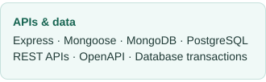
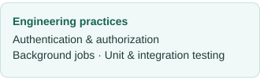

  

  
  &nbsp;
  

## A little about me

I'm Arshia, a backend developer working with **JavaScript and Node.js**. I enjoy turning complex workflows into clear APIs, with a focus on data integrity, access control, and thoughtful testing.

> **Currently learning:** deep learning and neural networks.

## My toolkit

  
   
  
  

---

  <strong>A little motion from my Contribution Snake 🐍</strong>

<picture>
  <source media="(prefers-color-scheme: dark)" srcset="https://raw.githubusercontent.com/MrEshrati/MrEshrati/gh-pages/github-contribution-grid-snake-dark.svg" />
  <source media="(prefers-color-scheme: light)" srcset="https://raw.githubusercontent.com/MrEshrati/MrEshrati/gh-pages/github-contribution-grid-snake.svg" />
  
</picture>

