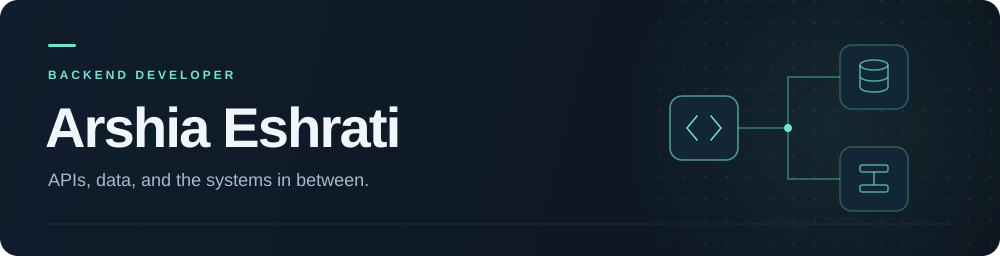

  

  <a href="https://www.linkedin.com/in/arshia-eshrati-691585242"><strong>LinkedIn ↗</strong></a> &nbsp; · &nbsp; <a href="mailto:arshiaeshrati1385@gmail.com"><strong>Email ↗</strong></a>

## A little about me

I'm Arshia, a backend developer working with **JavaScript, Node.js, and Python**. I enjoy turning complex workflows into clear APIs, with a focus on data integrity, access control, and thoughtful testing.

> **Currently learning:** deep learning and neural networks through Andrew Ng's course.

## My toolkit

| Area | Technologies |
| :--- | :--- |
| **Languages** | JavaScript · Python |
| **Backend** | Node.js · Express · Mongoose · REST APIs · OpenAPI |
| **Data** | MongoDB · PostgreSQL · Database transactions |
| **Tools & delivery** | Docker · nginx · GitHub Actions · Git · Linux |

Beyond the stack: **authentication & authorization**, **background jobs**, and **unit & integration testing**.

---

  
<strong>A little motion from my contributions</strong>

   

  <picture>
    <source media="(prefers-color-scheme: dark)" srcset="https://raw.githubusercontent.com/MrEshrati/MrEshrati/gh-pages/github-contribution-grid-snake-dark.svg" />
    <source media="(prefers-color-scheme: light)" srcset="https://raw.githubusercontent.com/MrEshrati/MrEshrati/gh-pages/github-contribution-grid-snake.svg" />
    
  </picture>

